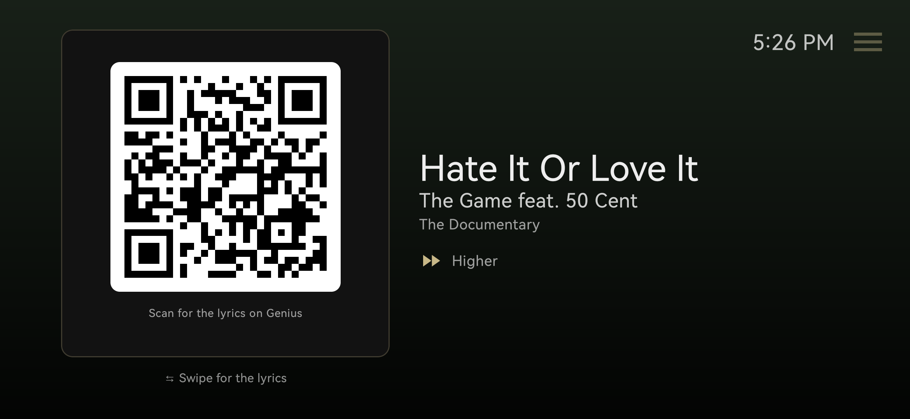
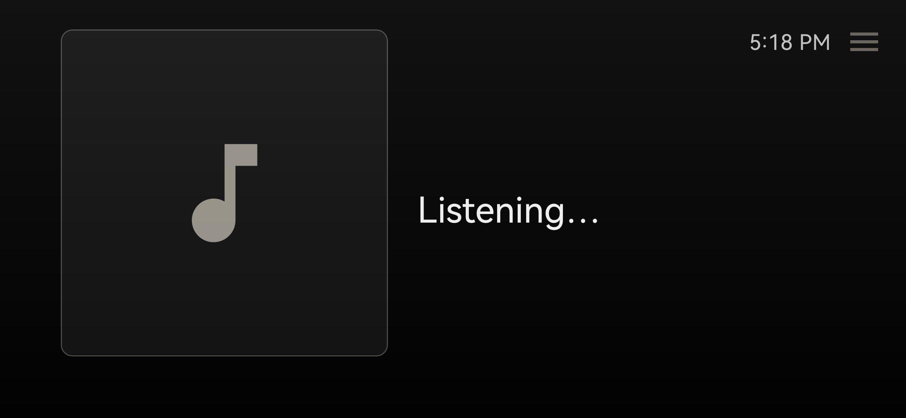

  

<h1 align="center">Roomtone</h1>

Ambient scrobbler for your records, CDs and tapes.

    

<a href="https://derefdev.github.io/roomtone/">Website</a> · <a href="https://derefdev.github.io/roomtone/docs/">Docs</a> · <a href="https://github.com/DerefDev/roomtone/releases/latest">Download</a>

Streaming services scrobble to Last.fm on their own. The music you play on
your hi-fi doesn't. Put a spare Android phone next to your speakers, and
Roomtone adds every record, CD or tape you play to your Last.fm profile,
written the way you already have it there.

## Screenshots

*Now playing: the cover of your record, the track, the album and what comes next.*

*Swipe the cover to flip it and scan the code for the lyrics on Genius.*

*Waiting for the next track while Auto Shazam listens.*

## Getting started

Install Roomtone with [Obtainium](https://github.com/ImranR98/Obtainium),
which installs apps from GitHub and keeps them up to date: install
Obtainium, then tap this button on the phone. The first time, Play Protect
may ask to scan Roomtone: let it scan, then install.

Or download the APK of the
[latest release](https://github.com/DerefDev/roomtone/releases/latest) and
install it yourself. Then:

1. Install [Shazam](https://www.shazam.com) on the same phone.
2. Open Roomtone and allow notification access and display over other apps,
   so it can read what Shazam recognizes and turn Auto Shazam on for you
   ([why](https://derefdev.github.io/roomtone/permissions/)).
3. Log in to Last.fm and, if you like, to Discogs.
4. Play a record, tape or CD.

If you install the APK from a file and Google Play Protect says "App blocked
to protect your device", see
[Play Protect blocks the installation](https://derefdev.github.io/roomtone/troubleshooting/#play-protect-blocks-the-installation).

Updates: with Obtainium, Obtainium tells you about new versions and installs
them. If you installed the APK yourself, Roomtone asks on first start whether
it may check GitHub once a day; if you say yes, it tells you when a new
version is out and can update itself.

Roomtone needs Android 8.0 or later.

## Features

- Shows the cover, title, artist, album and next track of what's playing
- Takes its colors from the cover
- Scrobbles only what you really listened to, and counts a track twice if you
  played it twice
- Scrobbles each song the way it already appears in your Last.fm history, so
  plays don't get split between two entries
- Or, in "Actual record" mode, scrobbles artist, title and album as they are
  on the record you own in your Discogs collection
- Asks which one to use when a song has several versions in your history, and
  remembers your choice
- Uses your Discogs collection for covers, album names and track titles
- Keeps listens that need a check as drafts you can fix, confirm or discard
- Saves listens on the phone and sends them when you're back online
- Turns Auto Shazam on and off for you
- Shows a QR code to the lyrics on Genius when you swipe the cover
- Switches to a dim clock and stops listening when no music is playing
- Optional cleanups for titles and albums, such as removing "Remastered"
- No ads, no account other than your own, no server of its own

## Status

Roomtone is in active development and has been tested on a single phone so
far.

Google Play Protect may block the installation from a file, because Roomtone
needs notification access to read what Shazam recognizes. Installing with
Obtainium avoids the block; see
[Play Protect blocks the installation](https://derefdev.github.io/roomtone/troubleshooting/#play-protect-blocks-the-installation).

## Docs

Also on the [website](https://derefdev.github.io/roomtone/docs/).

- [Recognition and listens](docs/recognition.md): how Roomtone follows Shazam
  and decides what counts as a listen
- [Scrobbling](docs/scrobbling.md): how tracks are matched with your Last.fm
  history and your Discogs collection, and sent
- [Lyrics and covers](docs/lyrics-and-covers.md): where covers and lyrics
  links come from
- [Troubleshooting](docs/troubleshooting.md): common problems and how to
  report one
- [Privacy](docs/privacy.md): what Roomtone stores and what it sends
- [Build from source](docs/build.md): building the app and the API keys it
  needs

## Translate

Help bring Roomtone to your language on [Crowdin](https://crowdin.com/project/roomtone).
See [Translations](docs/translations.md) for how it works.

## Credits

- App icon from ["Gramophone"](https://commons.wikimedia.org/wiki/File:Gramophone_(36104)_-_The_Noun_Project.svg) by Aarne Huttunen (The Noun Project)
- Icons from [Material Icons](https://github.com/google/material-design-icons)
- Music recognition from [Shazam](https://www.shazam.com)
- Scrobbling and listening history from [Last.fm](https://www.last.fm/api)
- Collection, tracklists and artwork from [Discogs](https://www.discogs.com/developers)
- Track durations and release data from [MusicBrainz](https://musicbrainz.org) and
  covers from [Cover Art Archive](https://coverartarchive.org)
- Durations, albums and covers from [Deezer](https://developers.deezer.com) and
  [iTunes](https://performance-partners.apple.com/search-api)
- Lyrics links from [Genius](https://docs.genius.com)
- QR codes from [ZXing](https://github.com/zxing/zxing)

Inspired by [Pano Scrobbler](https://github.com/kawaiiDango/pano-scrobbler) and
[Finale](https://github.com/nrubin29/finale).

Licenses and details are in [docs/credits.md](docs/credits.md).

## Disclaimer

Roomtone is an independent project, not affiliated with or endorsed by Shazam,
Apple, Last.fm, Discogs or Genius. Artwork and data remain the property of
their rights holders.

## License

Roomtone is released under the [GNU General Public License v3.0 or later](LICENSE).
