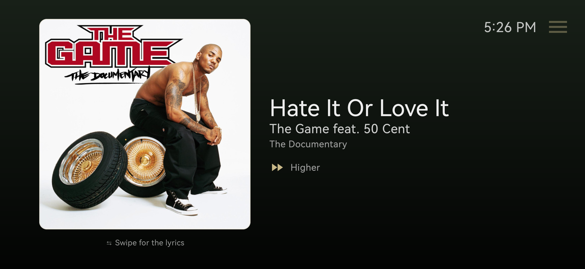

  

<h1 align="center">Roomtone</h1>

Ambient scrobbler for your records, CDs and tapes.

Streaming services scrobble to Last.fm on their own. The music you play on
your hi-fi doesn't. Put a spare Android phone next to your speakers, and
Roomtone adds every record, CD or tape you play to your Last.fm profile,
written the way you already have it there.

## Screenshots

*Now playing: the cover of your record, the track, the album and what comes next.*

*Swipe the cover to flip it and scan the code for the lyrics on Genius.*

*Waiting for the next track while Auto Shazam listens.*

## Getting started

1. Download the APK of the
   [latest release](https://github.com/DerefDev/roomtone/releases/latest) and
   install it on the phone.
2. Install [Shazam](https://www.shazam.com) on the same phone.
3. Open Roomtone and allow notification access and display over other apps,
   so it can read what Shazam recognizes and turn Auto Shazam on for you.
4. Log in to Last.fm and, if you like, to Discogs.
5. Play a record, tape or CD.

Roomtone needs Android 8.0 or later.

## Features

- Shows the cover, title, artist, album and next track of what's playing
- Takes its colors from the cover
- Scrobbles only what you really listened to, and counts a track twice if you
  played it twice
- Scrobbles each song the way it already appears in your Last.fm history, so
  plays don't get split between two entries
- Asks which one to use when a song has several versions in your history, and
  remembers your choice
- Uses your Discogs collection for covers, album names and track titles
- Keeps listens that need a check as drafts you can fix, confirm or discard
- Saves listens on the phone and sends them when you're back online
- Turns Auto Shazam on and off for you
- Shows a QR code to the lyrics on Genius when you swipe the cover
- Switches to a dim clock and stops listening when no music is playing
- Optional cleanups for titles and albums, such as removing "Remastered"
- No ads, no account other than your own, no server of its own

## Status

Roomtone is in active development and has been tested on a single phone so
far.

## Docs

- [Recognition and listens](docs/recognition.md): how Roomtone follows Shazam
  and decides what counts as a listen
- [Scrobbling](docs/scrobbling.md): how tracks are matched with your Last.fm
  history and your Discogs collection, and sent
- [Lyrics and covers](docs/lyrics-and-covers.md): where covers and lyrics
  links come from
- [Troubleshooting](docs/troubleshooting.md): common problems and how to
  report one
- [Privacy](docs/privacy.md): what Roomtone stores and what it sends
- [Build from source](docs/build.md): building the app and the API keys it
  needs

## Credits

- App icon from ["Gramophone"](https://commons.wikimedia.org/wiki/File:Gramophone_(36104)_-_The_Noun_Project.svg) by Aarne Huttunen (The Noun Project)
- Icons from [Material Icons](https://github.com/google/material-design-icons)
- Music recognition from [Shazam](https://www.shazam.com)
- Scrobbling and listening history from [Last.fm](https://www.last.fm/api)
- Collection, tracklists and artwork from [Discogs](https://www.discogs.com/developers)
- Track durations and release data from [MusicBrainz](https://musicbrainz.org) and
  covers from [Cover Art Archive](https://coverartarchive.org)
- Durations, albums and covers from [Deezer](https://developers.deezer.com) and
  [iTunes](https://performance-partners.apple.com/search-api)
- Lyrics links from [Genius](https://docs.genius.com)
- QR codes from [ZXing](https://github.com/zxing/zxing)

Inspired by [Pano Scrobbler](https://github.com/kawaiiDango/pano-scrobbler) and
[Finale](https://github.com/nrubin29/finale). Licenses and details are in
[docs/credits.md](docs/credits.md).

## Disclaimer

Roomtone is an independent project, not affiliated with or endorsed by Shazam,
Apple, Last.fm, Discogs or Genius. Artwork and data remain the property of
their rights holders.

## License

Roomtone is released under the [GNU General Public License v3.0 or later](LICENSE).
