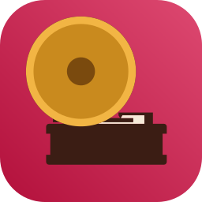

  

<h1 align="center">Roomtone</h1>

Scrobble the music you play at home: records, CDs, tapes.

Streaming services scrobble to Last.fm on their own. The music you play on
your hi-fi doesn't. Roomtone fills that gap: put a spare Android phone next to
your speakers, and every vinyl, CD or cassette you play ends up on your
Last.fm profile, written the way you already have it there.

## What it does

- **Shows what's playing.** The cover of the pressing you own, title, artist,
  album and the next track, with colors taken from the cover.
- **Scrobbles only what you really listened to.** A track that played for a
  few seconds while you changed the record doesn't count; one you played
  twice counts twice.
- **Keeps your profile tidy.** If a song is already on Last.fm as
  "Song - 2025 Remaster" from your streaming days, Roomtone scrobbles it the
  same way, so plays don't end up split between two entries.
- **Knows your collection.** Connect Discogs and Roomtone uses your own
  records for covers, album names and track titles.
- **Asks instead of guessing.** When something isn't clear, the listen waits
  as a draft for you to check, and your choices are remembered.
- **Works offline.** Listens are saved on the phone and sent when the
  connection is back.
- **Lyrics at hand.** Swipe the cover to flip it and scan a QR code that
  opens the lyrics on Genius.
- **Rests when you do.** After a while without music it switches to a dim
  clock and stops listening.

## Getting started

1. Download the APK of the
   [latest release](https://github.com/DerefDev/roomtone/releases/latest) and
   install it on the phone.
2. Install [Shazam](https://www.shazam.com) on the same phone.
3. Open Roomtone and allow notification access and display over other apps.
   Roomtone uses them to read what Shazam recognizes and to turn Auto Shazam
   on for you.
4. Log in to [Last.fm](https://www.last.fm) and, if you like, to
   [Discogs](https://www.discogs.com).
5. Put on a record.

Roomtone needs Android 8.0 or later. The interface is in English and Italian.

## Privacy

Roomtone has no server of its own. What you listen to stays on the phone,
apart from the scrobbles sent to your Last.fm account and the lookups made to
the music services Roomtone uses for track details, covers and lyrics. Login
sessions are stored encrypted on the device.

## Status

Roomtone is in active development (v0.8) and has been tested on a single
phone so far. Next up: running as the phone's home screen and starting
automatically when the phone turns on.

## More

- [Build from source](docs/build.md)
- [Credits and data sources](docs/credits.md)

Roomtone is an independent project, not affiliated with or endorsed by Shazam,
Apple, Last.fm, Discogs or Genius.

## License

Roomtone is free software, released under the
[GNU General Public License v3.0 or later](LICENSE).

Copyright (C) 2026 DerefDev
